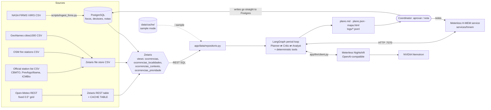
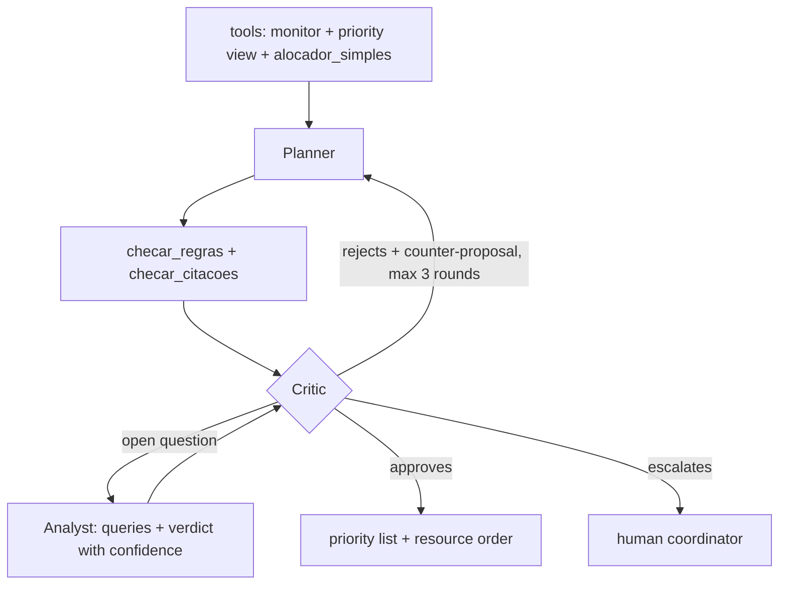

# FocoCerto

**When there are more wildfires than crews, FocoCerto helps a regional coordinator decide which fires to attend first and which resource to send to each one, and shows why.**

Open Agent Hackathon 2026 · **Track 3: Reasoning Architecture** · Team UFSM (Universidade Federal de Santa Maria, Brazil)

FocoCerto crosses NASA FIRMS heat detections with weather, nearby communities, real fire stations (each with its source) and the resources the coordinator declares. A **Planner** proposes a resource order, a **Critic** challenges it (trade-offs, exceptions from memory, when to escalate) and can call an **Analyst** to answer an open question with stated uncertainty. The output is a **priority list plus a resource order**, where every assignment carries its evidence. Nothing is dispatched without human approval.

> **Status, stated plainly:** the full pipeline runs end to end in **sample mode** (real cached FIRMS data, offline deterministic agents). **Meterless Nightshift works against the real service** since 25 Oct 2026 (~01:00 UTC): Nightshift for Windows on a team machine with an NVIDIA GPU, reached over Tailscale, serving `nvidia/nemotron-3-ultra-550b-a55b`; every call returns a signed receipt that the app logs. A full LLM-mode period (scarce scenario) took ~23 s with 2 calls (Planner and Critic). The **ablation in LLM mode is complete**: 144 runs, 450 Nemotron calls, 0 offline fallbacks; the full system passes 75.9% of the answer-key checks against 22.2% for a simple allocator, and no final plan carries a false citation (see [Evaluation](#evaluation)). **Zetaris works on a real instance** since 25 Oct 2026 (evening): Zetaris 2.4 in Docker on a team Debian server, reached over SSH/Tailscale; `scripts/setup_zetaris.py` registered the Postgres datasource, the file-store CSVs, the Open-Meteo REST table with `CACHE TABLE` and the 4 views with 0 failures, and `fococerto.ocorrencias_prioridade` returns 698 rows, the same as the Python reference. A **full real run** (data through Zetaris views, decisions by Nemotron through Nightshift, memory in the real H-MEM service) is in [`output_examples/tocantins-escasso-real/`](output_examples/tocantins-escasso-real/). See [Sponsor technology](#sponsor-technology) and [Limitations](#limitations).

---

## Contents
1. [Problem and user](#problem-and-user)
2. [Architecture](#architecture)
3. [Agent roles and the reasoning loop](#agent-roles-and-the-reasoning-loop)
4. [Dependencies](#dependencies)
5. [Setup](#setup)
6. [Usage](#usage) (CLI and HTTP API)
7. [Examples](#examples)
8. [Logs and traces](#logs-and-traces)
9. [Tests](#tests)
10. [Evaluation](#evaluation)
11. [Sponsor technology](#sponsor-technology)
12. [AI and Model Usage](#ai-and-model-usage)
13. [Limitations](#limitations)
14. [Credits and third-party components](#credits-and-third-party-components)

---

## Problem and user

**User:** the multi-agency coordination level (in Brazil, state situation rooms and integrated PrevFogo/Ibama/ICMBio structures; in the US, MAC groups and GACCs). This level sets **priorities between simultaneous incidents** and **allocates scarce resources**. FocoCerto is *not* an incident action plan tool: the incident commander keeps that.

**Problem:** public dashboards (FIRMS, GWIS/EFFIS, Painel do Fogo/BDQueimadas) show *where* the fire is and *how dangerous* conditions are. Dispatch systems record requests. We did not find an open tool that proposes *which incident to attend first and with whom*, with a critic that reviews trade-offs and exceptions and leaves an auditable justification. FocoCerto is positioned as a complement, not a replacement.

**Scale in our demo data (real FIRMS VIIRS/Suomi-NPP, Tocantins/Jalapão, Brazil, 23 Oct 2026):** 514 detections grouped into **179 occurrences** (~0.1° cells), **52** of them with a locality within 15 km. The demo scenario has **6 crews** at real, sourced stations (state fire brigade CBMTO and federal Prevfogo/Ibama brigades); how many crews each station has is **simulated**. Priorities follow the public incident-command doctrine: life → incident stabilization → property and environment.

The code is region-agnostic (a YAML file with a bounding box and declared assumptions). `config/regioes/` has Tocantins (demo, with cached data) and Iberia (configuration only; no cached data, not run).

---

## Architecture



Text version:

```
FIRMS -> Postgres ─┐
GeoNames, OSM, official stations CSV -> Zetaris file store ─┼─> Zetaris views (occurrences + context + priority) ─> Repository
Open-Meteo -> Zetaris REST table + CACHE ┘                                                       │
                                     (sample mode: data/cache/ instead of Zetaris) ──────────────┤
                                                                                                  ▼
            Nightshift (-> Nemotron) <─ app/llm/client.py ─ Planner ⇄ Critic ⇄ Analyst ─ H-MEM (:7070)
                                                                  │
                                plano.md / plano.json / mapa.html / logs/<run>.jsonl
                                                                  │
                                              Coordinator: aprovar (Postgres) / nota (Postgres + H-MEM)
```

- **Zetaris is the read path.** Agents read data through Zetaris views. Writes (approved decisions, coordinator notes) go straight to Postgres, because Zetaris is read-only over its sources.
- **All LLM calls go through `app/llm/client.py`** (`LLM_PROVIDER=nightshift|offline`). Nothing calls NVIDIA or any other provider directly; a test (`tests/test_integracao.py::test_sem_chamada_direta_a_nvidia_ou_outro_provedor`) enforces this.
- **Priority formula** (transparent, declared starting weights; `app/data/ocorrencias.py` and the same logic in `sql/zetaris_views.sql`):
  `0.35·exposure + 0.25·intensity (FRP) + 0.20·weather (VPD × wind, a surface simplification of Hot-Dry-Windy) + 0.10·persistence + 0.10·growth`.
- **ETA** = haversine distance × tortuosity factor ÷ declared speed (`config/regioes/tocantins.yaml`: 40 km/h, factor 1.4, max ETA 6 h; aircraft 180 km/h straight line).
- **Fire stations in layers, with provenance** (`app/data/bases.py`). A station is where a crew leaves from. Four layers, from most to least trusted: (1) `declarada`, declared by the coordinator in the scenario; (2) `oficial`, an official regional list with a source URL and year per station (`config/regioes/<region>_bases_oficiais.csv`, also registered in Zetaris as `fococerto_arq.bases_oficiais`); (3) `osm`, OpenStreetMap `amenity=fire_station`; (4) `estimada`, a municipal seat with 20,000+ inhabitants, used only when layers 2–3 have nothing inside the region (unverified). Stations closer than 3 km are merged and the most trusted record wins. Every plan labels each resource's station (`base oficial`, `base OSM`, …), lists the stations with their source in "Bases e procedência", and the map colours each station by layer. **Tocantins** has 12 official stations: the state fire brigade CBMTO (Palmas, Paraíso, Porto Nacional, Gurupi, Dianópolis, Colinas), federal Prevfogo/Ibama brigades from Ibama Portaria nº 114/2024 (São Félix do Tocantins, Santa Tereza do Tocantins, Itacajá, Goiatins, Arraias) and the ICMBio brigade of the Serra Geral do Tocantins ecological station (Rio da Conceição). Coordinates are the municipal seat from GeoNames (station addresses are not georeferenced), except Palmas, which uses the OSM point. **How many crews each station has is still simulated** (the scenario says so). In a real deployment, layer 2 would be the agency's own system (e.g. Sisfogo) federated through Zetaris instead of a CSV.

| Folder | What it holds |
|---|---|
| `app/core/` | shared types (pydantic), config, JSONL logger |
| `app/data/` | repository: `RepositorioZetaris` (Zetaris REST + Postgres writes) and `RepositorioCache` (sample mode); `bases.py` merges the station layers |
| `app/tools/` | deterministic tools: `monitor`, `checar_regras`, `checar_citacoes`, `alocador_simples`, `consultar`, `eta_h`, memory interpretation |
| `app/agents/` | Planner, Critic, Analyst, prompts, LangGraph graph |
| `app/llm/` | LLM client (Nightshift or offline) |
| `app/memory_client.py` | `ClienteHMEM` (HTTP) and `MemoriaLocal` (Python port, persistent, for sample mode) |
| `app/output/` | Markdown/JSON plan and Leaflet map |
| `app/api.py`, `web/` | HTTP API for a front end (FastAPI) and its contract (`web/README.md`) |
| `services/hmem/` | Meterless H-MEM reference engine as an HTTP service (TypeScript) |
| `sql/` | Postgres DDL, Zetaris views, Spark validation script |
| `scripts/` | ingestion, `setup_zetaris.py`, `check_submissao.py`, `check_clean_clone.sh`, `gerar_exemplos.sh` |
| `cenarios/` | coordinator scenarios (resources at sourced stations, reserve, notes); crew counts marked `simulado: true` |
| `config/regioes/` | region YAML (bbox, speeds, assumptions) and the official station list with sources |
| `eval/` | ablation scenarios, answer keys written before running, runner and report |

---

## Agent roles and the reasoning loop

### Deterministic tools (code, no LLM)
| Tool | What it does |
|---|---|
| `monitor` | compares with the previous day: `nova`, `crescendo`, `estavel`, `diminuindo` |
| `alocador_simples` | greedy baseline: highest priority gets the nearest feasible resource |
| `checar_regras` | hard rules (capacity, duplicate resource, ETA over the limit, unavailable resource, reserve not kept, exposed population left unattended while an unexposed occurrence got a resource, exposed occurrence with no feasible resource) plus soft "grey zone" flags (`exposta_nao_atendida`, `restricao_memoria`, and `troca_recurso_local`: an exposed occurrence has no resource while a crew that would reach it at least 0.5 h sooner went to another occurrence with similar or smaller exposure) |
| `checar_citacoes` | checks that every fact cited in a justification (locality, distance, population, ETA) matches the data |
| `consultar` | parameterized queries for the Analyst: 7-day cell history, day/night pattern, FRP pattern, persistence, protected-area proximity, weather |
| `interpretar_memorias` | reads H-MEM memories and notes for candidate facts (blocked base or route, reinforcement, minimum reserve). The Critic decides whether an exception applies |

### Agents (LLM through Nightshift; deterministic fallback offline)
| Agent | Decision that belongs to it |
|---|---|
| **Planner** (`planejador`) | builds the resource order starting from `alocador_simples`; may deviate, but must explain why; uses H-MEM memories |
| **Critic** (`critico`) | receives the rule and citation checker output and judges the grey zone: (1) trade-offs, (2) exceptions coming from memory (e.g. "road to São Félix flooded" overrides the nearest-station choice), (3) whether to escalate when no hard rule forces it. Writes a counter-proposal, e.g. moving a local crew onto the exposed occurrence it reaches first (`troca_recurso_local`) |
| **Analyst** (`analista`) | called **by the Critic** when a decision depends on an open question: *"is this occurrence likely recurrent agricultural/management burning, or a native-vegetation fire?"* Runs several queries and returns a conclusion with confidence (`baixa`/`media`/`alta`) |

### The loop is not linear



- Maximum 3 Planner→Critic rounds; at most one Analyst call per round.
- **Mandatory escalation** when an occurrence with exposed population is left without a resource (whether no resource can reach it in time or the feasible ones are committed elsewhere), or on deadlock after 3 rounds. The Critic **may** also escalate grey-zone cases, explaining why.
- **Guard rails in the graph** (`app/agents/grafo.py`): an approval with a solvable hard-rule violation is turned into a rejection; an approval with an unsolvable exposure violation becomes an escalation; and **every occurrence with exposed population that ends the final plan without a resource is escalated with the suggestion "solicitar apoio externo" (request external support), even if the Critic approved**, so the plan status becomes `escala`. *(This last guard rail was added on 25 Oct, after the ablations; the evaluation numbers below were measured before it.)*
- If the LLM output is invalid or Nightshift is unreachable, the agent falls back to its deterministic logic and logs `llm_call` with `status: fallback_offline`.

### Sample mode (offline deterministic agents)
`--sample` (or the environment variable `SAMPLE_MODE=true`, which works for every subcommand) runs **without Zetaris, Nightshift or any key**: data comes from `data/cache/` (real FIRMS, GeoNames, OSM and Open-Meteo data for 17–24 Oct 2026, frozen at 18:25 UTC on 24 Oct), memory is `MemoriaLocal`, and each agent uses its own `decidir_offline()` logic. Tools, rules and orchestration run for real on any input; there are no recorded answers (tests check that the code has no demo literals and that different inputs give different plans). In offline mode **the Planner is essentially the greedy baseline**; the Critic is the checker plus exception/trade-off/escalation rules; the Analyst is a persistence and day/night heuristic. The gains we expect from the LLM agents can only show up in LLM mode.

---

## Dependencies

| Needed for | What |
|---|---|
| Everything | Python 3.12, packages pinned in `requirements.txt` (pydantic, PyYAML, httpx, langgraph, psycopg, fastapi, uvicorn; pytest) |
| H-MEM service and its conformance suite | Node 24 (`services/hmem`, only dev dependency: `tsx`) |
| Real mode, data layer | **Zetaris** (Docker) + PostgreSQL |
| Real mode, AI | **Meterless Nightshift** (OpenAI-compatible endpoint), routing to **NVIDIA Nemotron** |
| Sample mode | nothing beyond Python |
| Map | browser; `mapa.html` loads Leaflet 1.9.4 from cdnjs |

---

## Setup

### 1. Python (sample mode works right after this)
```bash
git clone <this repo> fococerto && cd fococerto
python3.12 -m venv .venv
.venv/bin/pip install -r requirements.txt
.venv/bin/python -m app.cli run --sample --regiao tocantins --recursos cenarios/tocantins-escasso.yaml
```

### 2. Docker (alternative)
```bash
docker build -t fococerto .
docker run --rm fococerto            # default command = the sample run above
```
To keep the outputs on the host, mount volumes **and run as your user**, otherwise files are written as root:
```bash
mkdir -p out logs   # create them first; if Docker creates them they belong to root and the run fails with PermissionError
docker run --rm --user $(id -u):$(id -g) \
  -v "$PWD/out:/app/out" -v "$PWD/logs:/app/logs" fococerto
```
Real mode from Docker: `docker run --rm --env-file .env fococerto run --regiao tocantins --recursos cenarios/tocantins-escasso.yaml` (inside the container use `host.docker.internal` to reach Zetaris, Nightshift and Postgres).

### 3. Configuration
```bash
cp .env.example .env   # placeholders only; never commit .env
```
Without `ZETARIS_API_KEY` the CLI falls back to the cache; without `HMEM_URL` it uses `MemoriaLocal`; with `LLM_PROVIDER=offline` the agents run deterministically.

### 4. Meterless H-MEM service
```bash
cd services/hmem
npm ci
npm test      # official conformance suite against src/engine -> 13/13, saved to conformance-report.txt
npm start     # http://127.0.0.1:7070  (set HMEM_URL=http://127.0.0.1:7070 in .env)
```
`npm test` rewrites `services/hmem/conformance-report.txt` (it includes the run date), so the file shows up as modified in git; restore it with `git checkout services/hmem/conformance-report.txt`.

**Seeing the real H-MEM engine (no Zetaris, Nightshift or key needed).** `--sample` always uses `MemoriaLocal`, the Python port. To make the CLI talk to the TypeScript service instead, leave `npm start` running in one terminal and, in another, run **without** `--sample`, forcing the cache and the offline agents through environment variables (they take precedence over `.env`):
```bash
cd services/hmem && npm ci && npm start          # terminal 1, port 7070
# terminal 2, from the repository root:
export LLM_PROVIDER=offline HMEM_URL=http://127.0.0.1:7070 ZETARIS_API_KEY=
.venv/bin/python -m app.cli nota --regiao tocantins --periodo 2026-10-23 "estrada para São Félix alagada"
.venv/bin/python -m app.cli run  --regiao tocantins --recursos cenarios/tocantins-escasso.yaml
```
The CLI prints `Memória: H-MEM em http://127.0.0.1:7070` (instead of `MemoriaLocal`) and `Dados: cache local (data/cache/) [ZETARIS_API_KEY ausente]`. The empty `ZETARIS_API_KEY=` matters if your `.env` has a Zetaris key: with a key set, the CLI tries the real Zetaris. The service keeps its memories in `services/hmem/data/`.

### 5. Zetaris (data layer) — working on a real instance
Start Zetaris with the "Run locally" page of the Zetaris docs (Docker; the UI is at `http://localhost:3000`). Run Postgres on the `zetaris_default` Docker network so Zetaris can reach it, and set in `.env`: `ZETARIS_REST_URL`, `ZETARIS_ORG_ID`, `ZETARIS_API_KEY`, `POSTGRES_DSN`, `ZETARIS_PG_HOST` and `ZETARIS_PG_PORT` (host and port of Postgres **as seen from inside the Zetaris network**). Then:
```bash
.venv/bin/python scripts/ingest_firms.py --aplicar-schema   # tables: focos, recursos_periodo, decisoes, notas
.venv/bin/python scripts/ingest_firms.py --regiao tocantins --arquivo <FIRMS 7-day CSV>   # FIRMS -> Postgres (idempotent; or --janela 7d to download)
.venv/bin/python scripts/setup_zetaris.py --dry-run         # prints every Zetaris command, no Zetaris needed
.venv/bin/python scripts/setup_zetaris.py --regioes tocantins
.venv/bin/python scripts/setup_zetaris.py --so-cache        # re-run CACHE TABLE after a Zetaris restart
```
`setup_zetaris.py` registers everything by script: the Postgres JDBC datasource, the GeoNames/OSM/region CSVs in the file store (`docker cp` + `CREATE LIGHTNING FILESTORE TABLE … FORMAT CSV`), one Open-Meteo REST table per region with `CACHE TABLE`, and the views in `sql/zetaris_views.sql`. Other variables: `ZETARIS_DRIVER_CONTAINER`, `ZETARIS_FILESTORE_DIR`, and `ZETARIS_DOCKER_SSH=<host>` when Docker runs on another machine (the CSVs are copied over SSH). Finally run `python -m app.cli run --regiao tocantins --recursos cenarios/tocantins-escasso.yaml` **without** `--sample`: the CLI prints `Dados: Zetaris`, and the log records every SQL statement sent to Zetaris (`ferramenta`/`consulta` event with `fonte: zetaris`).

What the real instance taught us (25 Oct 2026, Zetaris 2.4 on a team Debian server over SSH/Tailscale): the REST endpoint answers `{headers, data}`, and the client was adjusted to that format; `DESCRIBE BY` descriptions only accept letters, digits and `_ . - ,`; and the Postgres port inside the Zetaris network differs from the one on the host (hence `ZETARIS_PG_PORT`). Result: 0 failures registering `fococerto_pg.focos` (1,875 real FIRMS detections, 17–24 Oct), `fococerto_arq.localidades` (107), `bases` (5, OSM), `bases_oficiais` (12), `regioes` (1), `fococerto.clima` (792 rows, cached) and the 4 views; `fococerto.ocorrencias_prioridade` returns **698 rows, equal to the Python reference**.

### 6. Meterless Nightshift (AI provider) — working against the real service
Run Nightshift, add the NVIDIA key in **Nightshift's Providers tab** (not in this project), and set in `.env`:
```
LLM_PROVIDER=nightshift
METERLESS_BASE_URL=http://127.0.0.1:8088/v1          # we reach a team machine over Tailscale: use its address
METERLESS_RUNTIME_TOKEN=<content of the runtime's proxy-token file>
METERLESS_MODEL=nvidia/nemotron-3-ultra-550b-a55b
```
Then run without `--sample`. What we learned on the real service (25 Oct 2026):
- **Token:** use the content of the runtime's `proxy-token` file; the token shown in the Nightshift UI returned 401.
- **Model:** ask for Nemotron by name. With `meterless/auto` the router may try to load a local model instead.
- **Reasoning off by default:** the client sends `chat_template_kwargs: {"enable_thinking": false}` (plus a `/no_think` system message). With reasoning on, Nemotron spent the whole 4096-token budget thinking and never wrote the JSON. `LLM_NO_THINK=0` turns reasoning back on. The client also strips any reasoning text glued before the answer (`…</think>`).
- Each call returns a signed receipt (`meterless.compute_receipt.v1`, Ed25519) with `routed_model` and a `receipt_id` (e.g. `rcpt_req_7yxkcil7`); the app writes both into every `llm_call` log line.

---

## Usage

Activate the virtual environment first (`source .venv/bin/activate`), or replace `python` below with `.venv/bin/python`.

```bash
source .venv/bin/activate

# Plan one period (writes out/<region>/<period>/plano.json, plano.md, mapa.html and logs/<run>.jsonl)
python -m app.cli run --regiao tocantins --recursos cenarios/tocantins-escasso.yaml [--periodo 2026-10-23] [--sample]

# Coordinator note: Postgres (or local state in sample mode) + H-MEM
python -m app.cli nota --regiao tocantins [--periodo P] [--autor A] "estrada para São Félix alagada"

# Approve the last saved plan of a period (writes the decisions)
python -m app.cli aprovar --regiao tocantins --periodo 2026-10-23

# Run the ablation: 12 scenarios x 4 variants x 3 repetitions (writes eval/resultados/<timestamp>_<mode>/)
python -m app.cli avaliar [--modo offline|llm] [--repeticoes N] [--variantes ABCD] [--cenarios ID ...] [--sample]
#   same as: python -m eval.run_ablacao --modo offline   (--modo llm needs Nightshift; --estimar prints the expected cost first)
```
Every subcommand (`run`, `nota`, `aprovar`, `avaliar`) accepts `--sample`; setting `SAMPLE_MODE=true` in the environment (or in `.env`) does the same for all of them (for `avaliar` it means `--modo offline`). Plan text follows the region's language (`idioma: pt-BR` for Tocantins).

**Memory demo you can reproduce in sample mode** (state is kept in `data/estado/`, git-ignored; delete it to start fresh). The note is about the Prevfogo/Ibama brigade station of São Félix do Tocantins:
```bash
python -m app.cli nota --sample --regiao tocantins --periodo 2026-10-23 "estrada para São Félix alagada"
python -m app.cli run  --sample --regiao tocantins --recursos cenarios/tocantins-escasso.yaml
#   -> saofelix-t1 is held in reserve, cel_-96_-468 (Lizarda) is escalated: 5 assignments, 10 escalations
python -m app.cli nota --sample --regiao tocantins --periodo 2026-10-24 "estrada para São Félix liberada"
#   -> "Substitui a memória tocantins:mem-1." (H-MEM supersedes)
python -m app.cli run  --sample --regiao tocantins --recursos cenarios/tocantins-escasso.yaml
#   -> saofelix-t1 goes back to cel_-96_-468: 6 assignments, 9 escalations
```

### HTTP API (for a front end)
```bash
.venv/bin/uvicorn app.api:app --port 8000      # OpenAPI at http://localhost:8000/docs
```
`app/api.py` is a thin FastAPI wrapper over the CLI: it decides nothing on its own. It reads the plans the CLI writes (`out/<region>/<period>/plano.json`), runs the same period loop as a background job, and writes notes and approvals through the same code paths. Endpoints: `GET /api/saude`, `/api/regioes`, `/api/periodos`, `/api/cenarios`, `/api/plano/{regiao}/{periodo}`, `/api/exemplos[/{nome}[/trace]]`, `/api/jobs[/{id}]`; `POST /api/run` (send `"sample": true` to run without any service), `/api/nota`, `/api/aprovar`. CORS is open to localhost only (`FOCOCERTO_CORS_ORIGENS` to change it); if `web/dist/` exists, the API also serves it at `/`. The full contract for the front end, with real request and response bodies, is in [`web/README.md`](web/README.md).

---

## Examples

All examples except `tocantins-escasso-real/` are produced by real `--sample` runs (`scripts/gerar_exemplos.sh`) on real FIRMS data for **23 Oct 2026** (the Analyst example: 24 Oct); the stations are real (official layer, with source) and the **number of crews per station is simulated**. The app never reads these folders.

| Input (`input_examples/`) | Resources | Output (`output_examples/`) | Result |
|---|---|---|---|
| `tocantins-escasso.yaml` | 6, reserve 0 | `tocantins-escasso/` | 6 assignments, 9 escalations |
| `tocantins-medio.yaml` | 10, reserve 1 | `tocantins-medio/` | 8 assignments, 7 escalations, 1 in reserve |
| `tocantins-folgado.yaml` | 16, reserve 2 | `tocantins-folgado/` | 13 assignments, 2 escalations, 3 in reserve (`palmas-t2`, `palmas-t3`, `paraiso-t1`) |
| `tocantins-escasso.yaml` + note *"estrada para São Félix alagada, sem acesso"* | 6 | `tocantins-escasso-com-nota/` | 5 assignments, 10 escalations: the Critic accepts the memory exception, `saofelix-t1` (Prevfogo/Ibama, São Félix do Tocantins) no longer goes by road to `cel_-96_-468` (Lizarda), stays in reserve, and that occurrence is escalated |
| `tocantins-parana-analista.yaml` (copy of the eval scenario `agricola_recorrente_parana_24out`, period 24 Oct) | 5, reserve 0 | `tocantins-parana-analista/` | 5 assignments, 3 escalations. The Critic calls the Analyst about `cel_-124_-479` (no population nearby); after 7 queries it answers **`indeterminado`, confidence `baixa`** (low FRP and far from protected areas, but the occurrence is growing), so the assignment is kept as a precaution. The scarce scenario above never calls the Analyst |
| `tocantins-escasso.yaml`, **real run** (no `--sample`, LLM mode) | 6, reserve 0 | `tocantins-escasso-real/` | 6 assignments, 9 mandatory escalations, 2 Planner ⇄ Critic rounds, ~2.5 min. Data through the **real Zetaris** views (6 SQL queries, mode `views`, listed in the trace), decisions by **Nemotron 3 Ultra through Nightshift** (4 calls, each with its `rcpt_req_…` receipt), memory in the **real H-MEM service** (port 7070; no memory existed yet for this period). In round 1 the Critic rejected the plan and asked for 3 `troca_recurso_local` swaps (e.g. `dianopolis-t1` to Dianópolis, 22,424 people, ETA 0.16 h); round 2 adopted them and the Critic approved |

Each output folder has `plano.md` (human-readable plan: escalations, resource order, priority list, justifications with evidence ids, memories used, review cycle, limitations), `plano.json` (the same as data, read by `aprovar`), `mapa.html` (Leaflet) and `trace.jsonl` (the full event log).

Stations: the Tocantins scenarios above (including the real run) use only stations from the official layer (CBMTO and Prevfogo/Ibama, each with a source URL in `config/regioes/tocantins_bases_oficiais.csv`); each `plano.md` has a "Bases e procedência" table and the banner "Bases: localização real com fonte; quantidade de equipes simulada (cenário)". The Analyst example is a copy of an evaluation scenario written before the layered stations existed, so it still uses 5 stations **declared** by the coordinator in real GeoNames towns (unverified units), and its plan says so.

---

## Logs and traces

Every relevant event is one line in `logs/<run>.jsonl`:
```json
{"t":"…","execucao":"…","regiao":"tocantins","periodo":"2026-10-23","agente":"planejador|critico|analista|ferramenta|sistema",
 "evento":"inicio|proposta|violacao|rejeita|aprova|escala|consulta|memoria_lida|memoria_gravada|llm_call|fim",
 "dados":{…},"modelo":null,"routed_model":null,"receipt":null,"tokens":null,"latencia_s":null}
```
In LLM mode each `llm_call` line records `modelo`, `routed_model` and `receipt` (which model actually answered). In sample mode these fields are `null` because no model is called, and the run is labelled `offline_deterministico`.

---

## Tests

```bash
(cd services/hmem && npm ci)                        # first: without it the H-MEM HTTP tests below are skipped
.venv/bin/python -m pytest -q                       # 221 passed, 1 skipped on 25 Oct (the skip needs a throwaway Postgres: POSTGRES_DSN_TESTE)
(cd services/hmem && npm test)                      # H-MEM conformance: 13/13 checks passed (rewrites conformance-report.txt)
.venv/bin/python scripts/check_submissao.py         # secrets, .env, examples, README sections, repo size, dates
scripts/check_clean_clone.sh                        # fresh clone -> venv -> pytest -> run --sample -> npm ci && npm test
```
The test suite covers the tools and rules, the agents' offline logic, the graph, the LLM client (with a fake HTTP layer, including `routed_model`/`receipt` extraction), the memory client (`MemoriaLocal` vs the real H-MEM service, a 3-period supersedes test, region scoping), the repository, the outputs, and anti-cheating integration tests (no demo literals, different inputs give different plans, no direct provider calls).

---

## Evaluation

The Track 3 question: **do the agents and the memory make better decisions?** We compare four variants on scenarios where the right answer is *not* given by the rule checker, each checked against an answer key **written and committed before any run** (commit `1d722b5`, "Avaliação: cenários e gabaritos escritos antes de qualquer execução").

| Variant | Description |
|---|---|
| **A** | `alocador_simples` alone |
| **B** | Planner + rule checker feeding back (no LLM Critic) |
| **C** | B + Critic + Analyst + H-MEM (full system) |
| **D** | C without H-MEM |

**12 scenarios** on real FIRMS data (`eval/cenarios/`, answer keys in `eval/gabaritos/`): legitimate exceptions coming from memory (a flooded road out of a station, scenario `excecao_mateiros_alagada_23out`, and a Dianópolis bridge) with a control case (road reopened); recurrent agricultural burning with a native-vegetation control; exposure-vs-ETA trade-offs and escalation; justifications with an injected wrong fact (population, locality, and an invented trend that `checar_citacoes` does not cover); reignitions visible only through data-derived memory. Control cases measure false alarms. The evaluation scenarios were frozen with the answer keys on 24 Oct, before the layered stations existed, so they use stations **declared** by the coordinator in real GeoNames towns (unverified units, marked simulated); we did not change them afterwards.

**Metrics:** answer-key accuracy (split into decision, detection and false alarm), false citations, exposure-weighted ETA (how long, on average, exposed population waits for a resource), rounds to approval, escalations, and variance over **3 runs per scenario and variant**.

**Honesty notes:** the answer keys were written by the team, there is no field ground truth, and the reservations for each case are in the key itself. The agents' code already existed when the keys were committed (commit `e06ec8d`, 28 minutes before `1d722b5`), and after the first offline runs we fixed **7 bugs** that we found because checks failed (commit `39e42d2`). The fixes are general behaviour fixes with regression tests, each one documented with how to reproduce it in `eval/RELATORIO.md`, but they were made after seeing the results, and the "before" table is kept there. In offline mode every run is deterministic and A and B tend to coincide, so offline results only validate the pipeline; **the comparison that matters is in LLM mode**. Details: `eval/README.md` and `eval/RELATORIO.md`.

**Offline mode (deterministic agents).** These numbers validate the evaluation pipeline (12 scenarios × 4 variants ×
3 repetitions, `python -m eval.run_ablacao --modo offline --repeticoes 3`, code of 24 Oct); the LLM-mode table below is
the comparison that answers the Track 3 question. Offline runs are deterministic, so the variance between repetitions is zero.

| Variant | Checks passed | Decision | Detection | False alarms | False citations in final plan |
|---|---|---|---|---|---|
| **A** simple allocator | 18/81 (22.2%) | 15/51 | 0/27 | 0/3 | 0 |
| **B** Planner + rule checker | 48/81 (59.3%) | 27/51 | 18/27 | 0/3 | 0 |
| **C** full (Planner ⇄ Critic ⇄ Analyst + H-MEM) | 69/87 (79.3%) | 36/51 | 27/30 | 0/6 | 0 |
| **D** C without H-MEM | 51/87 (58.6%) | 30/51 | 15/30 | 0/6 | 0 |

H-MEM contribution (C − D): +18 checks (coordinator notes and data-derived reignition memories). Full table,
per-scenario results and the before/after of the bug fixes: `eval/RELATORIO.md`.

### LLM mode: NVIDIA Nemotron 3 Ultra through Meterless Nightshift

Same 12 scenarios × 4 variants × 3 repetitions, with every agent decision made by `nvidia/nemotron-3-ultra-550b-a55b`
through a real Meterless Nightshift (25 Oct 2026): **144 runs, 450 LLM calls, 449 valid on the first try, 1 invalid JSON
recovered by the retry, 0 fallbacks to offline**, mean latency 29 s per call. Results: `eval/resultados/20261025T015525Z_llm/`.

| Variant | Checks passed | Decision | Detection | False alarms | Citation flags raised (see note) | False citations in final plan |
|---|---|---|---|---|---|---|
| **A** simple allocator | 18/81 (22.2%) | 15/51 | 0/27 | 0/3 | n/a | 6 (injected; A has no checker) |
| **B** Planner + rule checker | 53/81 (65.4%) | 32/51 | 18/27 | 0/3 | 56 | **0** |
| **C** full (Planner ⇄ Critic ⇄ Analyst + H-MEM) | 66/87 (75.9%) | 36/51 | 24/30 | 0/6 | 54 | **0** |
| **D** C without H-MEM | 64/87 (73.6%) | 37/51 | 21/30 | 0/6 | 47 | **0** |

What this shows, and what it does not:

- **No false citation reaches a final plan** of B, C or D (verified by re-running `checar_citacoes` on all 108 final
  plans). **Correction (25 Oct):** the "citation flags" column overstates the model's errors. A later review of the traces
  found that part of the flags were false positives of our own checker (it read "within the 6 h limit" as a cited ETA,
  and the departure base name as a cited locality). The checker was fixed; the true number of model errors will be
  re-measured in the next LLM run.
- **The LLM Critic catches what code cannot.** In `fato_errado_tendencia` (a false trend claim no tool checks) B fails and
  C and D pass in all repetitions; in `tradeoff_noite_gurupi` the LLM variants pass where the offline agents failed.
- **Memory adds little in LLM mode:** C − D is +2 checks (it was +18 offline). With Nemotron, the variant without memory
  already reasons well from the period data, and the reignition case in Conceição fails in every variant. We report this
  as measured.
- **Stable across repetitions:** standard deviation of the accuracy between repetitions ≤ 0.018; plans differ between
  repetitions in 2 of 12 scenarios.
- **Exposure-weighted ETA** (how long exposed people wait for a crew): 4.40 h for A, 3.77 h for C.
- **Per single run, not per 81/87.** The totals above add up 3 repetitions of the same 27 checks (A, B) or 29 checks
  (C, D). Per run, LLM mode gives A 6.0/27, B 17.7/27, C 22.0/29, D 21.3/29 (offline: 6, 16, 23 and 17). So in LLM mode
  C − D is 0.67 of a check per run, within the run-to-run variation of D: **with this sample we cannot claim that memory
  improves LLM mode** (offline, C − D is 6 checks per run).
- **No over-escalation in any variant, in either mode** (0 escalated occurrences without exposed population or with a
  free, feasible, unblocked resource beyond the reserve), so the answer keys' credit for escalating did not reward
  "escalate everything". Honest caveat: **in LLM mode every escalation came from a deadlock** ("3 rounds without
  approval", mostly a citation the Planner could not fix), not from a decision to ask for help; 18 of those 46
  escalations are in the two control scenarios, a false alarm the accuracy table does not show; and the check "every
  exposed occurrence without a resource is escalated" fails in B, C and D. This is being addressed (the
  "solicitar apoio externo" guard rail above and Critic changes), and the LLM ablation has **not** been re-run since.
  Details: `eval/RELATORIO.md` ("Sobre-escalação").

#### Second LLM run, after the fixes (25 Oct, evening)

1 repetition × 12 scenarios × 4 variants = 48 runs, 137 Nemotron calls, all valid, 0 offline fallbacks, mean latency
25 s. Results: `eval/resultados/20261025T220912Z_llm/`. Changes since the first run: citations corrected before the
Critic, mandatory escalation of exposed occurrences, idle-local-crew swap, real sourced bases, no grey-zone impasses.

| Variant | Checks passed | Exposure-weighted ETA |
|---|---|---|
| **A** simple allocator | 6/27 (22.2%) | 4.40 h |
| **B** Planner + rule checker | 21/27 (77.8%) | 4.00 h |
| **C** full (Planner ⇄ Critic ⇄ Analyst + H-MEM) | 24/29 (82.8%) | 3.48 h |
| **D** C without H-MEM | 24/29 (82.8%) | 3.48 h |

- **Model errors, measured honestly:** the system rewrote **24 wrong facts** written by Nemotron before the Critic saw
  the plan (12 distances, 6 localities, 6 populations), each one logged as a `citacao_corrigida` event. No final plan
  of B, C or D carries a false citation.
- **Impasses went from 30 to 6**, and the remaining 6 are legitimate: the model kept violating a hard rule (the same
  crew assigned twice, or an arrival time above the limit) for three rounds, so the decision goes to the human.
- **Memory made no difference in this run** (C and D are identical). We report it as measured.

A real trace with Nemotron calls, routed model and signed receipt ids: [`output_examples/nemotron-trace/trace.jsonl`](output_examples/nemotron-trace/trace.jsonl).


---

## Sponsor technology

Full write-up: [`docs/PATROCINADORES.md`](docs/PATROCINADORES.md).

| Sponsor | Role in FocoCerto | Status |
|---|---|---|
| **Zetaris** | Data layer: federates Postgres (FIRMS detections), file-store CSVs (GeoNames localities, OSM stations, the official station list with sources, region table) and an Open-Meteo REST table with `CACHE TABLE`; four views compute occurrences, localities, context and priority. Registered entirely by `scripts/setup_zetaris.py` | **Working on a real instance** (Zetaris 2.4 in Docker on a team server, 25 Oct 2026): setup with 0 failures; `fococerto.ocorrencias_prioridade` returns **698 rows, equal to the Python reference**; a full real run reads its data through the views (`output_examples/tocantins-escasso-real/`, 6 SQL queries logged). Earlier the same views had been checked in a local Spark SQL 4.0 (698/698, `sql/validar_views_spark.py`) |
| **Meterless H-MEM** | Memory across periods, scoped per region: coordinator notes become memories that change the plan; a contradicting note **supersedes** the old one; data-derived memories (e.g. "cell X was deprioritized and grew") raise priority | Official Meterless reference engine (Apache-2.0) in `services/hmem/`, adaptations marked "FocoCerto adaptation". **Conformance 13/13** (`npm test`). Persistent Python port `MemoriaLocal` for sample mode, checked against the service in tests |
| **Meterless Nightshift** | Primary AI provider for Planner, Critic and Analyst, via its OpenAI-compatible endpoint; each call logs `modelo`, `routed_model`, `receipt` | **Working against the real service** since 25 Oct 2026: Nightshift for Windows on a team GPU machine over Tailscale; each call returns a signed receipt (`meterless.compute_receipt.v1`, Ed25519) logged in every `llm_call`. Also unit-tested with a fake HTTP layer |
| **NVIDIA Nemotron** | The reasoning model behind the agents, reached only through Nightshift | `nvidia/nemotron-3-ultra-550b-a55b` answers the real calls (`routed_model` in the log); one LLM-mode period ≈ 23 s, 2 calls. LLM-mode ablation complete: 144 runs, 450 calls, 0 offline fallbacks ([Evaluation](#evaluation)) |

---

## AI and Model Usage

**Models (through Meterless Nightshift).** One model, `nvidia/nemotron-3-ultra-550b-a55b` (NVIDIA Nemotron 3 Ultra), requested by name, in three roles:
- **Planner**: builds the resource order from the greedy baseline and the tool outputs, may deviate with a written justification.
- **Critic**: judges the grey zone (trade-offs, exceptions from memory, swaps, when to escalate) and writes the counter-proposal.
- **Analyst**: called by the Critic for an open question ("recurrent agricultural burning or native-vegetation fire?"), answers with a conclusion and a confidence level.

**Reasoning is turned off** (`chat_template_kwargs: {"enable_thinking": false}` plus a `/no_think` system message; `LLM_NO_THINK=0` turns it back on). On the real service, with reasoning on, Nemotron spent the whole 4096-token budget thinking and never returned the JSON the agents need. Numbers (ETA, population, distances) always come from deterministic tools, never from the model, and every fact the model cites is re-checked by `checar_citacoes`. No embedding model is used: H-MEM uses the reference engine's deterministic embedder.

**Agent frameworks and libraries.** LangGraph (the Planner ⇄ Critic ⇄ Analyst loop), pydantic (typed contracts and validation of every LLM output), httpx (Nightshift, Zetaris and H-MEM clients), FastAPI + uvicorn (HTTP API), psycopg, PyYAML, pytest; Node 24 + tsx for the H-MEM service; Leaflet for the map. Versions are pinned in `requirements.txt` and `services/hmem/package-lock.json`.

**Sponsor technology** (details in [`docs/PATROCINADORES.md`](docs/PATROCINADORES.md)):
- **Zetaris**: the read path. It federates Postgres (FIRMS), file-store CSVs (GeoNames, OSM, official stations) and an Open-Meteo REST table; four SQL views compute occurrences, exposure and priority. **Working on a real Zetaris 2.4** (698 rows from `ocorrencias_prioridade`, equal to the Python reference; full real run in `output_examples/tocantins-escasso-real/`).
- **Meterless Engine: H-MEM**: memory across periods per region (coordinator notes that change the plan, supersedes, data-derived memories). Official reference engine, conformance suite 13/13.
- **Meterless Nightshift**: the only AI provider; every call goes through `app/llm/client.py` (OpenAI-compatible) and logs `modelo`, `routed_model` and the signed `receipt`.
- **NVIDIA**: Nemotron 3 Ultra answers every agent call, reached only through Nightshift.

**AI coding tool.** The code was written and reviewed with **Claude Code (Anthropic)**, used for writing code, tests and documentation and for reviewing them. The team reviewed and tested the result and is responsible for it.

**Data sources, and what is simulated.**
- Real: NASA FIRMS VIIRS detections (17–24 Oct 2026), GeoNames localities and population, OpenStreetMap fire stations, Open-Meteo weather, and the official Tocantins station list (CBMTO, Prevfogo/Ibama Portaria nº 114/2024, ICMBio), each station with its source URL.
- Simulated, and labelled as such in every plan: **how many crews and aircraft each station has** (the scenario), the coordinator notes of the demo, the stations declared in the evaluation scenarios, and the wrong facts injected in the evaluation.

**Adapted open-source code.** The Meterless H-MEM reference engine (Apache-2.0), copied into `services/hmem/src/engine/` with small marked adaptations for Portuguese; see [Credits](#credits-and-third-party-components).

**Sample mode.** `SAMPLE_MODE=true` (or `--sample`) runs the whole pipeline on cached real data with offline deterministic agents and the local H-MEM port, with no calls to Zetaris, Nightshift or any other service, and no keys. The tools and rules run for real; there are no recorded answers. In sample mode the log fields `modelo`, `routed_model` and `receipt` are `null`. If Nightshift fails during a real run, the agent falls back to its deterministic logic and logs `status: fallback_offline` (0 times in the 450-call LLM ablation).

**Known limitations:** see [Limitations](#limitations).

---

## Limitations

- **Only one full real run (Zetaris + Nightshift + H-MEM together):** `output_examples/tocantins-escasso-real/`, one period of Tocantins. The ablation reads the local cache of the same real data (`RepositorioCache`, real Nemotron), not Zetaris. The REST weather table depends on `CACHE TABLE`, which is lost when Zetaris restarts (`setup_zetaris.py --so-cache` re-creates it).
- **The evaluation predates the latest agent changes:** both ablations were measured before the "solicitar apoio externo" guard rail and the `troca_recurso_local` rule (25 Oct). In LLM mode all escalations came from deadlocks, and the memory gain (C − D) is within run-to-run noise. Small sample: 27–29 checks per run, written by the team.
- **Offline agents are simple:** in sample mode the Planner is essentially the greedy baseline; differences between ablation variants depend on LLM mode.
- **Data-derived memories are learned between periods**: before each `run`, the system compares the previous period's plan with the new FIRMS data and stores, for example, "cell X was left without a resource and grew from 2 to 8 detections" (`app/agents/aprendizado.py`). Each ablation scenario has a single period, so the ablation seeds these memories; the multi-period effect is shown by `scripts/demo_3_periodos.sh`.
- **Exposure is overestimated near mid-size towns:** `pop_raio` sums GeoNames population, which is often the whole municipality (e.g. Porto Nacional ~53k), not just the town.
- **A detection is not a fire:** the same fire is detected several times, clouds hide fires, and part of the detections are agricultural or industrial burning. Agricultural-vs-native-vegetation is an inference with stated uncertainty.
- **Distances are straight lines × a tortuosity factor**, and speeds are declared assumptions; ETA is an estimate.
- **The weather term is a simplified surface Hot-Dry-Windy** (VPD × wind from Open-Meteo daily maxima).
- **Indigenous lands and protected areas are not ingested** (`dist_ti_uc_km` is null).
- **Crew counts are simulated; station locations are real but approximate.** The demo stations come from public sources (CBMTO news, Ibama Portaria nº 114/2024, ICMBio), with the municipal seat as coordinate (except Palmas). Some CBMTO companies were reorganised in 2023: each station "exists according to the cited source", not according to an up-to-date official inventory. The evaluation scenarios and the Analyst example still use coordinator-declared stations. GeoNames lists only places with 1,000+ inhabitants.
- **No validation with operators:** the framing comes from public incident-command doctrine; the doctrine is simplified.
- The H-MEM embedder is the reference's deterministic mock, so recall is lexical, not semantic.
- The region pipeline is generic, but only Tocantins has cached data; Iberia has a configuration only.

---

## Credits and third-party components

| Component | Use | License / terms |
|---|---|---|
| **Meterless H-MEM reference engine** (`github.com/meterless/meterless`, `engines/hmem`, commit `1742dec`) | copied into `services/hmem/src/engine/`; conformance runner and vectors unmodified; adaptations listed in `services/hmem/NOTICE` | Apache-2.0 (`services/hmem/LICENSE-meterless-hmem`) |
| **NASA FIRMS** (VIIRS S-NPP active fire, 7-day CSV) | heat detections | NASA open data |
| **GeoNames** `cities1000` | localities and population | CC BY 4.0 |
| **OpenStreetMap** (Overpass, `amenity=fire_station`) | fire stations | ODbL, © OpenStreetMap contributors |
| **Open-Meteo** forecast API | VPD, wind, humidity, precipitation | CC BY 4.0 |
| **Official Tocantins station list** (`config/regioes/tocantins_bases_oficiais.csv`) | station names and agencies, compiled by the team from public sources (CBMTO news, Ibama Portaria nº 114/2024, ICMBio); one URL and year per row | public information, cited per row |
| **Leaflet** 1.9.4 | map | BSD-2-Clause |
| LangGraph, pydantic, httpx, FastAPI, uvicorn, psycopg, PyYAML, pytest, tsx | libraries | their own open-source licenses |

All other code was written during the hackathon build window (first commit 24 Oct 2026), with Claude Code as the AI coding tool (see [AI and Model Usage](#ai-and-model-usage)); the team is accountable for it.
