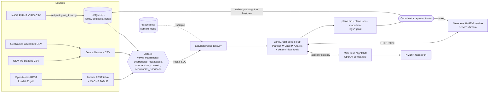
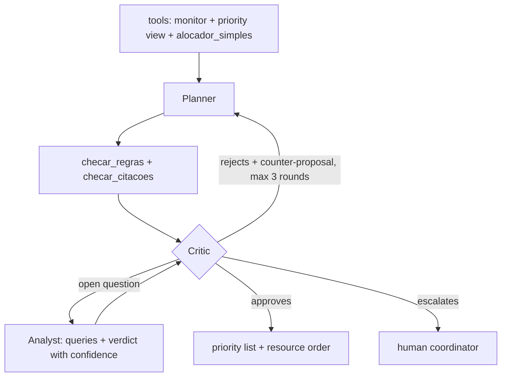

# FocoCerto

**When there are more wildfires than crews, FocoCerto helps a regional coordinator decide which fires to attend first and which resource to send to each one, and shows why.**

Open Agent Hackathon 2026 · **Track 3: Reasoning Architecture** · Team UFSM (Universidade Federal de Santa Maria, Brazil)

FocoCerto crosses NASA FIRMS heat detections with weather, nearby communities, fire stations and the resources the coordinator declares. A **Planner** proposes a resource order, a **Critic** challenges it (trade-offs, exceptions from memory, when to escalate) and can call an **Analyst** to answer an open question with stated uncertainty. The output is a **priority list plus a resource order**, where every assignment carries its evidence. Nothing is dispatched without human approval.

> **Status, stated plainly:** the full pipeline runs end to end in **sample mode** (real cached FIRMS data, offline deterministic agents). **Meterless Nightshift works against the real service** since 25 Oct 2026 (~01:00 UTC): Nightshift for Windows on a team machine with an NVIDIA GPU, reached over Tailscale, serving `nvidia/nemotron-3-ultra-550b-a55b`; every call returns a signed receipt that the app logs. A full LLM-mode period (scarce scenario) took ~23 s with 2 calls (Planner and Critic). The **ablation in LLM mode is running and has no results yet**. The **Zetaris** integration is implemented but **not yet tested on a real Zetaris instance** (views validated only in a local Spark SQL). See [Sponsor technology](#sponsor-technology) and [Limitations](#limitations).

---

## Contents
1. [Problem and user](#problem-and-user)
2. [Architecture](#architecture)
3. [Agent roles and the reasoning loop](#agent-roles-and-the-reasoning-loop)
4. [Dependencies](#dependencies)
5. [Setup](#setup)
6. [Usage](#usage)
7. [Examples](#examples)
8. [Logs and traces](#logs-and-traces)
9. [Tests](#tests)
10. [Evaluation](#evaluation)
11. [Sponsor technology](#sponsor-technology)
12. [Limitations](#limitations)
13. [Credits and third-party components](#credits-and-third-party-components)

---

## Problem and user

**User:** the multi-agency coordination level (in Brazil, state situation rooms and integrated PrevFogo/Ibama/ICMBio structures; in the US, MAC groups and GACCs). This level sets **priorities between simultaneous incidents** and **allocates scarce resources**. FocoCerto is *not* an incident action plan tool: the incident commander keeps that.

**Problem:** public dashboards (FIRMS, GWIS/EFFIS, Painel do Fogo/BDQueimadas) show *where* the fire is and *how dangerous* conditions are. Dispatch systems record requests. We did not find an open tool that proposes *which incident to attend first and with whom*, with a critic that reviews trade-offs and exceptions and leaves an auditable justification. FocoCerto is positioned as a complement, not a replacement.

**Scale in our demo data (real FIRMS VIIRS/Suomi-NPP, Tocantins/Jalapão, Brazil, 23 Oct 2026):** 514 detections grouped into **179 occurrences** (~0.1° cells), **52** of them with a locality within 15 km. The demo scenario has **6 resources** (simulated). Priorities follow the public incident-command doctrine: life → incident stabilization → property and environment.

The code is region-agnostic (a YAML file with a bounding box and declared assumptions). `config/regioes/` has Tocantins (demo, with cached data) and Iberia (configuration only; no cached data, not run).

---

## Architecture



Text version:

```
FIRMS -> Postgres ─┐
GeoNames, OSM CSV -> Zetaris file store ─┼─> Zetaris views (occurrences + context + priority) ─> Repository
Open-Meteo -> Zetaris REST table + CACHE ┘                                                       │
                                     (sample mode: data/cache/ instead of Zetaris) ──────────────┤
                                                                                                  ▼
            Nightshift (-> Nemotron) <─ app/llm/client.py ─ Planner ⇄ Critic ⇄ Analyst ─ H-MEM (:7070)
                                                                  │
                                plano.md / plano.json / mapa.html / logs/<run>.jsonl
                                                                  │
                                              Coordinator: aprovar (Postgres) / nota (Postgres + H-MEM)
```

- **Zetaris is the read path.** Agents read data through Zetaris views. Writes (approved decisions, coordinator notes) go straight to Postgres, because Zetaris is read-only over its sources.
- **All LLM calls go through `app/llm/client.py`** (`LLM_PROVIDER=nightshift|offline`). Nothing calls NVIDIA or any other provider directly; a test (`tests/test_integracao.py::test_sem_chamada_direta_a_nvidia_ou_outro_provedor`) enforces this.
- **Priority formula** (transparent, declared starting weights; `app/data/ocorrencias.py` and the same logic in `sql/zetaris_views.sql`):
  `0.35·exposure + 0.25·intensity (FRP) + 0.20·weather (VPD × wind, a surface simplification of Hot-Dry-Windy) + 0.10·persistence + 0.10·growth`.
- **ETA** = haversine distance × tortuosity factor ÷ declared speed (`config/regioes/tocantins.yaml`: 40 km/h, factor 1.4, max ETA 6 h; aircraft 180 km/h straight line).

| Folder | What it holds |
|---|---|
| `app/core/` | shared types (pydantic), config, JSONL logger |
| `app/data/` | repository: `RepositorioZetaris` (Zetaris REST + Postgres writes) and `RepositorioCache` (sample mode) |
| `app/tools/` | deterministic tools: `monitor`, `checar_regras`, `checar_citacoes`, `alocador_simples`, `consultar`, `eta_h`, memory interpretation |
| `app/agents/` | Planner, Critic, Analyst, prompts, LangGraph graph |
| `app/llm/` | LLM client (Nightshift or offline) |
| `app/memory_client.py` | `ClienteHMEM` (HTTP) and `MemoriaLocal` (Python port, persistent, for sample mode) |
| `app/output/` | Markdown/JSON plan and Leaflet map |
| `services/hmem/` | Meterless H-MEM reference engine as an HTTP service (TypeScript) |
| `sql/` | Postgres DDL, Zetaris views, Spark validation script |
| `scripts/` | ingestion, `setup_zetaris.py`, `check_submissao.py`, `check_clean_clone.sh`, `gerar_exemplos.sh` |
| `cenarios/` | coordinator scenarios (resources, declared bases, reserve, notes); all marked `simulado: true` |
| `eval/` | ablation scenarios, answer keys written before running, runner and report |

---

## Agent roles and the reasoning loop

### Deterministic tools (code, no LLM)
| Tool | What it does |
|---|---|
| `monitor` | compares with the previous day: `nova`, `crescendo`, `estavel`, `diminuindo` |
| `alocador_simples` | greedy baseline: highest priority gets the nearest feasible resource |
| `checar_regras` | hard rules (capacity, duplicate resource, ETA over the limit, unavailable resource, reserve not kept, exposed population left unattended while an unexposed occurrence got a resource, exposed occurrence with no feasible resource) plus soft "grey zone" flags (`exposta_nao_atendida`, `restricao_memoria`) |
| `checar_citacoes` | checks that every fact cited in a justification (locality, distance, population, ETA) matches the data |
| `consultar` | parameterized queries for the Analyst: 7-day cell history, day/night pattern, FRP pattern, persistence, protected-area proximity, weather |
| `interpretar_memorias` | reads H-MEM memories and notes for candidate facts (blocked base or route, reinforcement, minimum reserve). The Critic decides whether an exception applies |

### Agents (LLM through Nightshift; deterministic fallback offline)
| Agent | Decision that belongs to it |
|---|---|
| **Planner** (`planejador`) | builds the resource order starting from `alocador_simples`; may deviate, but must explain why; uses H-MEM memories |
| **Critic** (`critico`) | receives the rule and citation checker output and judges the grey zone: (1) trade-offs, (2) exceptions coming from memory (e.g. "road to Mateiros flooded" overrides the nearest-base choice), (3) whether to escalate when no hard rule forces it. Writes a counter-proposal |
| **Analyst** (`analista`) | called **by the Critic** when a decision depends on an open question: *"is this occurrence likely recurrent agricultural/management burning, or a native-vegetation fire?"* Runs several queries and returns a conclusion with confidence (`baixa`/`media`/`alta`) |

### The loop is not linear



- Maximum 3 Planner→Critic rounds; at most one Analyst call per round.
- **Mandatory escalation** when an occurrence with exposed population is left without a resource (whether no resource can reach it in time or the feasible ones are committed elsewhere), or on deadlock after 3 rounds. The Critic **may** also escalate grey-zone cases, explaining why. *(The "left without a resource" rule is a team decision being enforced in the code after the current LLM-mode ablation; the numbers in this README were measured before it.)*
- **Guard rails in the graph:** an approval with a solvable hard-rule violation is turned into a rejection; an approval with an unsolvable exposure violation becomes an escalation (`app/agents/grafo.py`).
- If the LLM output is invalid or Nightshift is unreachable, the agent falls back to its deterministic logic and logs `llm_call` with `status: fallback_offline`.

### Sample mode (offline deterministic agents)
`--sample` runs **without Zetaris, Nightshift or any key**: data comes from `data/cache/` (real FIRMS, GeoNames, OSM and Open-Meteo data for 17–24 Oct 2026, frozen at 18:25 UTC on 24 Oct), memory is `MemoriaLocal`, and each agent uses its own `decidir_offline()` logic. Tools, rules and orchestration run for real on any input; there are no recorded answers (tests check that the code has no demo literals and that different inputs give different plans). In offline mode **the Planner is essentially the greedy baseline**; the Critic is the checker plus exception/trade-off/escalation rules; the Analyst is a persistence and day/night heuristic. The gains we expect from the LLM agents can only show up in LLM mode.

---

## Dependencies

| Needed for | What |
|---|---|
| Everything | Python 3.12, packages pinned in `requirements.txt` (pydantic, PyYAML, httpx, langgraph, psycopg; pytest) |
| H-MEM service and its conformance suite | Node 24 (`services/hmem`, only dev dependency: `tsx`) |
| Real mode, data layer | **Zetaris** (Docker) + PostgreSQL |
| Real mode, AI | **Meterless Nightshift** (OpenAI-compatible endpoint), routing to **NVIDIA Nemotron** |
| Sample mode | nothing beyond Python |
| Map | browser; `mapa.html` loads Leaflet 1.9.4 from cdnjs |

---

## Setup

### 1. Python (sample mode works right after this)
```bash
git clone <this repo> fococerto && cd fococerto
python3.12 -m venv .venv
.venv/bin/pip install -r requirements.txt
.venv/bin/python -m app.cli run --sample --regiao tocantins --recursos cenarios/tocantins-escasso.yaml
```

### 2. Docker (alternative)
```bash
docker build -t fococerto .
docker run --rm fococerto            # default command = the sample run above
```
To keep the outputs on the host, mount volumes **and run as your user**, otherwise files are written as root:
```bash
mkdir -p out logs   # create them first; if Docker creates them they belong to root and the run fails with PermissionError
docker run --rm --user $(id -u):$(id -g) \
  -v "$PWD/out:/app/out" -v "$PWD/logs:/app/logs" fococerto
```
Real mode from Docker: `docker run --rm --env-file .env fococerto run --regiao tocantins --recursos cenarios/tocantins-escasso.yaml` (inside the container use `host.docker.internal` to reach Zetaris, Nightshift and Postgres).

### 3. Configuration
```bash
cp .env.example .env   # placeholders only; never commit .env
```
Without `ZETARIS_API_KEY` the CLI falls back to the cache; without `HMEM_URL` it uses `MemoriaLocal`; with `LLM_PROVIDER=offline` the agents run deterministically.

### 4. Meterless H-MEM service
```bash
cd services/hmem
npm ci
npm test      # official conformance suite against src/engine -> 13/13, saved to conformance-report.txt
npm start     # http://127.0.0.1:7070  (set HMEM_URL=http://127.0.0.1:7070 in .env)
```
`npm test` rewrites `services/hmem/conformance-report.txt` (it includes the run date), so the file shows up as modified in git; restore it with `git checkout services/hmem/conformance-report.txt`.

**Seeing the real H-MEM engine (no Zetaris, Nightshift or key needed).** `--sample` always uses `MemoriaLocal`, the Python port. To make the CLI talk to the TypeScript service instead, leave `npm start` running in one terminal and, in another, run **without** `--sample`, forcing the cache and the offline agents through environment variables (they take precedence over `.env`):
```bash
cd services/hmem && npm ci && npm start          # terminal 1, port 7070
# terminal 2, from the repository root:
export LLM_PROVIDER=offline HMEM_URL=http://127.0.0.1:7070 ZETARIS_API_KEY=
.venv/bin/python -m app.cli nota --regiao tocantins --periodo 2026-10-23 "estrada para Mateiros alagada"
.venv/bin/python -m app.cli run  --regiao tocantins --recursos cenarios/tocantins-escasso.yaml
```
The CLI prints `Memória: H-MEM em http://127.0.0.1:7070` (instead of `MemoriaLocal`) and `Dados: cache local (data/cache/) [ZETARIS_API_KEY ausente]`. The empty `ZETARIS_API_KEY=` matters if your `.env` has a Zetaris key: with a key set, the CLI tries the real Zetaris. The service keeps its memories in `services/hmem/data/`.

### 5. Zetaris (data layer) — implemented, not yet run against a real instance
Follow the Participant Setup Guide (HackOS Resource Center) to start Zetaris in Docker, then:
```bash
.venv/bin/python scripts/ingest_firms.py --aplicar-schema   # tables: focos, recursos_periodo, decisoes, notas
.venv/bin/python scripts/ingest_firms.py --regiao tocantins --janela 7d   # FIRMS -> Postgres (idempotent)
.venv/bin/python scripts/setup_zetaris.py --dry-run         # prints every Zetaris command, no Zetaris needed
.venv/bin/python scripts/setup_zetaris.py --regioes tocantins
.venv/bin/python scripts/setup_zetaris.py --so-cache        # re-run CACHE TABLE after a Zetaris restart
```
`setup_zetaris.py` registers everything by script: the Postgres JDBC datasource, the GeoNames/OSM/region CSVs in the file store (`docker cp` + `CREATE LIGHTNING FILESTORE TABLE … FORMAT CSV`), one Open-Meteo REST table per region with `CACHE TABLE`, and the views in `sql/zetaris_views.sql`. Variables: `ZETARIS_REST_URL`, `ZETARIS_API_KEY`, `ZETARIS_ORG_ID`, `POSTGRES_DSN`, `ZETARIS_PG_HOST`, `ZETARIS_DRIVER_CONTAINER`, `ZETARIS_FILESTORE_DIR`.

### 6. Meterless Nightshift (AI provider) — working against the real service
Run Nightshift, add the NVIDIA key in **Nightshift's Providers tab** (not in this project), and set in `.env`:
```
LLM_PROVIDER=nightshift
METERLESS_BASE_URL=http://127.0.0.1:8088/v1          # we reach a team machine over Tailscale: use its address
METERLESS_RUNTIME_TOKEN=<content of the runtime's proxy-token file>
METERLESS_MODEL=nvidia/nemotron-3-ultra-550b-a55b
```
Then run without `--sample`. What we learned on the real service (25 Oct 2026):
- **Token:** use the content of the runtime's `proxy-token` file; the token shown in the Nightshift UI returned 401.
- **Model:** ask for Nemotron by name. With `meterless/auto` the router may try to load a local model instead.
- **Reasoning off by default:** the client sends `chat_template_kwargs: {"enable_thinking": false}` (plus a `/no_think` system message). With reasoning on, Nemotron spent the whole 4096-token budget thinking and never wrote the JSON. `LLM_NO_THINK=0` turns reasoning back on. The client also strips any reasoning text glued before the answer (`…</think>`).
- Each call returns a signed receipt (`meterless.compute_receipt.v1`, Ed25519) with `routed_model` and a `receipt_id` (e.g. `rcpt_req_7yxkcil7`); the app writes both into every `llm_call` log line.

---

## Usage

Activate the virtual environment first (`source .venv/bin/activate`), or replace `python` below with `.venv/bin/python`.

```bash
source .venv/bin/activate

# Plan one period (writes out/<region>/<period>/plano.json, plano.md, mapa.html and logs/<run>.jsonl)
python -m app.cli run --regiao tocantins --recursos cenarios/tocantins-escasso.yaml [--periodo 2026-10-23] [--sample]

# Coordinator note: Postgres (or local state in sample mode) + H-MEM
python -m app.cli nota --regiao tocantins [--periodo P] [--autor A] "estrada para Mateiros alagada"

# Approve the last saved plan of a period (writes the decisions)
python -m app.cli aprovar --regiao tocantins --periodo 2026-10-23

# Run the ablation: 12 scenarios x 4 variants x 3 repetitions (writes eval/resultados/<timestamp>_<mode>/)
python -m eval.run_ablacao --modo offline            # --modo llm needs Nightshift; --estimar prints the expected cost first
```
Every subcommand (`run`, `nota`, `aprovar`) accepts `--sample`. Plan text follows the region's language (`idioma: pt-BR` for Tocantins).

**Memory demo you can reproduce in sample mode** (state is kept in `data/estado/`, git-ignored; delete it to start fresh):
```bash
python -m app.cli nota --sample --regiao tocantins --periodo 2026-10-23 "estrada para Mateiros alagada"
python -m app.cli run  --sample --regiao tocantins --recursos cenarios/tocantins-escasso.yaml
#   -> mateiros-t1 is held in reserve, cel_-96_-468 (Lizarda) is escalated: 5 assignments, 10 escalations
python -m app.cli nota --sample --regiao tocantins --periodo 2026-10-24 "estrada para Mateiros liberada"
#   -> "Substitui a memória tocantins:mem-1." (H-MEM supersedes)
python -m app.cli run  --sample --regiao tocantins --recursos cenarios/tocantins-escasso.yaml
#   -> mateiros-t1 goes back to cel_-96_-468: 6 assignments, 9 escalations
```

---

## Examples

All examples are produced by real `--sample` runs (`scripts/gerar_exemplos.sh`) on real FIRMS data for **23 Oct 2026** (the Analyst example: 24 Oct); resources are **simulated**. The app never reads these folders.

| Input (`input_examples/`) | Resources | Output (`output_examples/`) | Result |
|---|---|---|---|
| `tocantins-escasso.yaml` | 6, reserve 0 | `tocantins-escasso/` | 6 assignments, 9 escalations |
| `tocantins-medio.yaml` | 10, reserve 1 | `tocantins-medio/` | 8 assignments, 7 escalations, 1 in reserve |
| `tocantins-folgado.yaml` | 16, reserve 2 | `tocantins-folgado/` | 14 assignments, 1 escalation, 2 in reserve |
| `tocantins-escasso.yaml` + note *"estrada para Mateiros alagada, sem acesso"* | 6 | `tocantins-escasso-com-nota/` | 5 assignments, 10 escalations: the Critic accepts the memory exception, `mateiros-t1` no longer goes by road to `cel_-96_-468` (Lizarda) and that occurrence is escalated |
| `tocantins-parana-analista.yaml` (copy of the eval scenario `agricola_recorrente_parana_24out`, period 24 Oct) | 5, reserve 0 | `tocantins-parana-analista/` | 5 assignments, 3 escalations. The Critic calls the Analyst about `cel_-124_-479` (no population nearby); after 7 queries it answers **`indeterminado`, confidence `baixa`** (low FRP and far from protected areas, but the occurrence is growing), so the assignment is kept as a precaution. The scarce scenario above never calls the Analyst |

Each output folder has `plano.md` (human-readable plan: escalations, resource order, priority list, justifications with evidence ids, memories used, review cycle, limitations), `plano.json` (the same as data, read by `aprovar`), `mapa.html` (Leaflet) and `trace.jsonl` (the full event log).

Bases: OpenStreetMap has only **2 fire stations inside Tocantins, both in Palmas**. The other bases are declared by the coordinator in the scenario, in real GeoNames towns, and marked `simulada: true`.

---

## Logs and traces

Every relevant event is one line in `logs/<run>.jsonl`:
```json
{"t":"…","execucao":"…","regiao":"tocantins","periodo":"2026-10-23","agente":"planejador|critico|analista|ferramenta|sistema",
 "evento":"inicio|proposta|violacao|rejeita|aprova|escala|consulta|memoria_lida|memoria_gravada|llm_call|fim",
 "dados":{…},"modelo":null,"routed_model":null,"receipt":null,"tokens":null,"latencia_s":null}
```
In LLM mode each `llm_call` line records `modelo`, `routed_model` and `receipt` (which model actually answered). In sample mode these fields are `null` because no model is called, and the run is labelled `offline_deterministico`.

---

## Tests

```bash
(cd services/hmem && npm ci)                        # first: without it the H-MEM HTTP tests below are skipped
.venv/bin/python -m pytest -q                       # 176 passed, 1 skipped (needs a throwaway Postgres: POSTGRES_DSN_TESTE)
(cd services/hmem && npm test)                      # H-MEM conformance: 13/13 checks passed (rewrites conformance-report.txt)
.venv/bin/python scripts/check_submissao.py         # secrets, .env, examples, README sections, repo size, dates
scripts/check_clean_clone.sh                        # fresh clone -> venv -> pytest -> run --sample -> npm ci && npm test
```
The test suite covers the tools and rules, the agents' offline logic, the graph, the LLM client (with a fake HTTP layer, including `routed_model`/`receipt` extraction), the memory client (`MemoriaLocal` vs the real H-MEM service, a 3-period supersedes test, region scoping), the repository, the outputs, and anti-cheating integration tests (no demo literals, different inputs give different plans, no direct provider calls).

---

## Evaluation

The Track 3 question: **do the agents and the memory make better decisions?** We compare four variants on scenarios where the right answer is *not* given by the rule checker, each checked against an answer key **written and committed before any run** (commit `fcf42df`, "Avaliação: cenários e gabaritos escritos antes de qualquer execução").

| Variant | Description |
|---|---|
| **A** | `alocador_simples` alone |
| **B** | Planner + rule checker feeding back (no LLM Critic) |
| **C** | B + Critic + Analyst + H-MEM (full system) |
| **D** | C without H-MEM |

**12 scenarios** on real FIRMS data (`eval/cenarios/`, answer keys in `eval/gabaritos/`): legitimate exceptions coming from memory (Mateiros road flooded, Dianópolis bridge) with a control case (road reopened); recurrent agricultural burning with a native-vegetation control; exposure-vs-ETA trade-offs and escalation; justifications with an injected wrong fact (population, locality, and an invented trend that `checar_citacoes` does not cover); reignitions visible only through data-derived memory. Control cases measure false alarms.

**Metrics:** answer-key accuracy (split into decision, detection and false alarm), false citations, exposure-weighted ETA (how long, on average, exposed population waits for a resource), rounds to approval, escalations, and variance over **3 runs per scenario and variant**.

**Honesty notes:** the answer keys were written by the team, there is no field ground truth, and the reservations for each case are in the key itself. The agents' code already existed when the keys were committed (commit `0cfcb66`, 28 minutes before `fcf42df`), and after the first offline runs we fixed **7 bugs** that we found because checks failed (commit `b97dfe7`). The fixes are general behaviour fixes with regression tests, each one documented with how to reproduce it in `eval/RELATORIO.md`, but they were made after seeing the results, and the "before" table is kept there. In offline mode every run is deterministic and A and B tend to coincide, so offline results only validate the pipeline; **the comparison that matters is in LLM mode**. Details: `eval/README.md` and `eval/RELATORIO.md`.

**Ablation results: offline deterministic agents — LLM-mode results pending.** These numbers validate the
evaluation pipeline (12 scenarios × 4 variants × 3 repetitions, `python -m eval.run_ablacao --modo offline --repeticoes 3`);
they are not the final comparison. Offline runs are deterministic, so the variance between repetitions is zero.

| Variant | Checks passed | Decision | Detection | False alarms | False citations in final plan |
|---|---|---|---|---|---|
| **A** simple allocator | 18/81 (22.2%) | 15/51 | 0/27 | 0/3 | 0 |
| **B** Planner + rule checker | 48/81 (59.3%) | 27/51 | 18/27 | 0/3 | 0 |
| **C** full (Planner ⇄ Critic ⇄ Analyst + H-MEM) | 69/87 (79.3%) | 36/51 | 27/30 | 0/6 | 0 |
| **D** C without H-MEM | 51/87 (58.6%) | 30/51 | 15/30 | 0/6 | 0 |

H-MEM contribution (C − D): +18 checks (coordinator notes and data-derived reignition memories). Full table,
per-scenario results and the before/after of the bug fixes: `eval/RELATORIO.md`.

<!-- EVAL_RESULTS_LLM -->

---

## Sponsor technology

Full write-up: [`docs/PATROCINADORES.md`](docs/PATROCINADORES.md).

| Sponsor | Role in FocoCerto | Status |
|---|---|---|
| **Zetaris** | Data layer: federates Postgres (FIRMS detections), file-store CSVs (GeoNames localities, OSM stations, region table) and an Open-Meteo REST table with `CACHE TABLE`; four views compute occurrences, localities, context and priority. Registered entirely by `scripts/setup_zetaris.py` | Views validated in a local **Spark SQL 4.0** against the Python logic (**698/698 occurrences identical**, `sql/validar_views_spark.py`). **Not yet run on a real Zetaris.** Missing: a running Zetaris + `.env`, then `setup_zetaris.py` and `run` without `--sample` |
| **Meterless H-MEM** | Memory across periods, scoped per region: coordinator notes become memories that change the plan; a contradicting note **supersedes** the old one; data-derived memories (e.g. "cell X was deprioritized and grew") raise priority | Official Meterless reference engine (Apache-2.0) in `services/hmem/`, adaptations marked "FocoCerto adaptation". **Conformance 13/13** (`npm test`). Persistent Python port `MemoriaLocal` for sample mode, checked against the service in tests |
| **Meterless Nightshift** | Primary AI provider for Planner, Critic and Analyst, via its OpenAI-compatible endpoint; each call logs `modelo`, `routed_model`, `receipt` | **Working against the real service** since 25 Oct 2026: Nightshift for Windows on a team GPU machine over Tailscale; each call returns a signed receipt (`meterless.compute_receipt.v1`, Ed25519) logged in every `llm_call`. Also unit-tested with a fake HTTP layer |
| **NVIDIA Nemotron** | The reasoning model behind the agents, reached only through Nightshift | `nvidia/nemotron-3-ultra-550b-a55b` answers the real calls (`routed_model` in the log); one LLM-mode period ≈ 23 s, 2 calls. LLM-mode ablation running, no results yet |

---

## Limitations

- **Zetaris not yet tested on a real instance:** the views were validated only in a local Spark SQL 4.0. Nightshift/Nemotron does run against the real service, but the **LLM-mode ablation has no results yet**, so we cannot yet say whether the LLM agents beat the offline ones.
- **Offline agents are simple:** in sample mode the Planner is essentially the greedy baseline; differences between ablation variants depend on LLM mode.
- **Data-derived memories are learned between periods**: before each `run`, the system compares the previous period's plan with the new FIRMS data and stores, for example, "cell X was left without a resource and grew from 2 to 8 detections" (`app/agents/aprendizado.py`). Each ablation scenario has a single period, so the ablation seeds these memories; the multi-period effect is shown by `scripts/demo_3_periodos.sh`.
- **Exposure is overestimated near mid-size towns:** `pop_raio` sums GeoNames population, which is often the whole municipality (e.g. Porto Nacional ~53k), not just the town.
- **A detection is not a fire:** the same fire is detected several times, clouds hide fires, and part of the detections are agricultural or industrial burning. Agricultural-vs-native-vegetation is an inference with stated uncertainty.
- **Distances are straight lines × a tortuosity factor**, and speeds are declared assumptions; ETA is an estimate.
- **The weather term is a simplified surface Hot-Dry-Windy** (VPD × wind from Open-Meteo daily maxima).
- **Indigenous lands and protected areas are not ingested** (`dist_ti_uc_km` is null).
- **Resources and most bases are simulated** (only the Palmas station from OSM is real in the demo scenarios). GeoNames lists only places with 1,000+ inhabitants.
- **No validation with operators:** the framing comes from public incident-command doctrine; the doctrine is simplified.
- The H-MEM embedder is the reference's deterministic mock, so recall is lexical, not semantic.
- The region pipeline is generic, but only Tocantins has cached data; Iberia has a configuration only.

---

## Credits and third-party components

| Component | Use | License / terms |
|---|---|---|
| **Meterless H-MEM reference engine** (`github.com/meterless/meterless`, `engines/hmem`, commit `1742dec`) | copied into `services/hmem/src/engine/`; conformance runner and vectors unmodified; adaptations listed in `services/hmem/NOTICE` | Apache-2.0 (`services/hmem/LICENSE-meterless-hmem`) |
| **NASA FIRMS** (VIIRS S-NPP active fire, 7-day CSV) | heat detections | NASA open data |
| **GeoNames** `cities1000` | localities and population | CC BY 4.0 |
| **OpenStreetMap** (Overpass, `amenity=fire_station`) | fire stations | ODbL, © OpenStreetMap contributors |
| **Open-Meteo** forecast API | VPD, wind, humidity, precipitation | CC BY 4.0 |
| **Leaflet** 1.9.4 | map | BSD-2-Clause |
| LangGraph, pydantic, httpx, psycopg, PyYAML, pytest, tsx | libraries | their own open-source licenses |

All other code was written during the hackathon build window (first commit 24 Oct 2026). Generated with AI coding assistance; the team is accountable for it.
